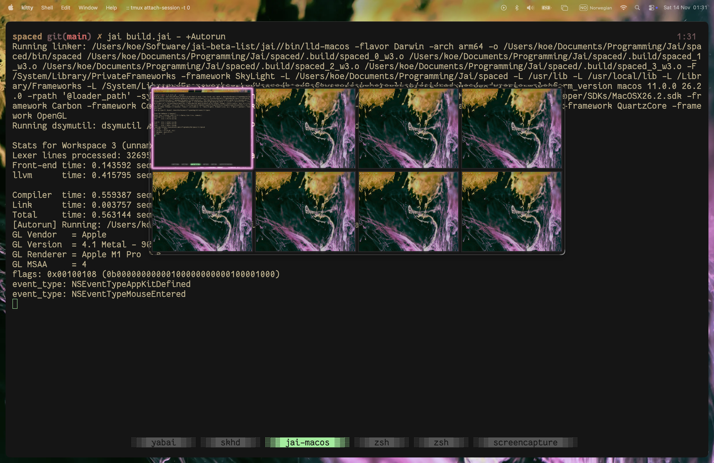

<h2 align="center">
    spaced
</h2>

  <b>Grid-based space management for macOS.</b>

  
  

    

### System Requirements

 - Architecture: Apple Silicon
 - Operating System: macOS 26 Tahoe
    
### Features

 - Visualize space thumbnails in grid overview by holding down `<mod>` for 1 second.
 - Switch between spaces by left-clicking a thumbnail while overview mode is active.
 - Switch between spaces in grid, skipping animation, by tapping `<mod> + <arrow-key>`.
 - Shortcuts are not affected by Secure Input (Secure Keyboard Entry) limitations.

Quit by holding `<mod>` until the overview is visible, then press `q`.

### Permissions

 - Requires access to CGEventPost API to synthesize native space switch events.  
   Effectively, this is the same as granting access to the Accessibility API.
 - Requires Screen Capture access to display space thumbnails in overview mode.  
   Desktop Wallpaper will be shown if Screen Capture access is not granted. 

### Start on login

Open `System Settings`. Choose `General` and select `Login Items & Extensions`.  
In the top section labeled `Open at Login`, click the `+` symbol and select `spaced.app` in your `/Applications` folder.
